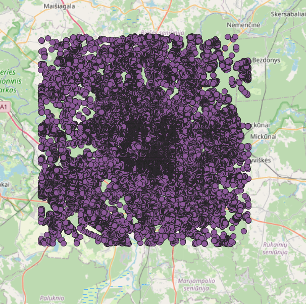
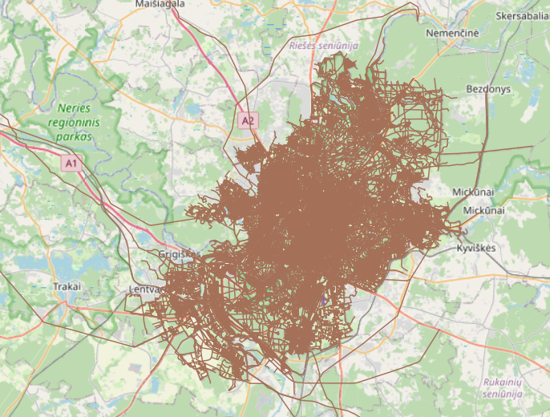
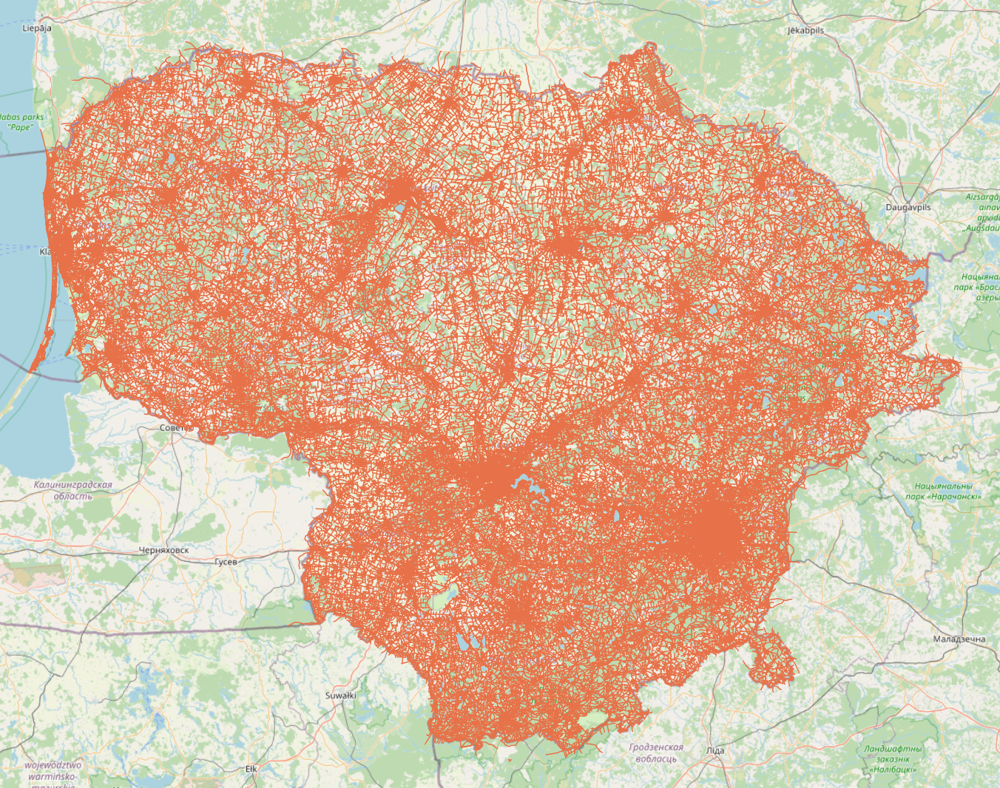

The Road Graph Tool is a project for processing data from various sources into a road graph usable as an input for transportation problems. Version 0.1.0 of the project targets to provide a road network with the following features:

- geographical location of vertices and edges, and
- geographical shape of edges

The version 0.1.0 use the following data sources:

- OpenStreetMap (OSM) data for the road network and its geographical properties,

The processing and storage of the data are done in a PostgreSQL/PostGIS database. To manipulate the database, import data to the database, and export data from the database, the project provides a set of Python scripts.


# Dependencies
To run the tool, you need access to a local or remote PostgreSQL database with the following extensions installed:

- [PostGIS](https://postgis.net/)
- [PgRouting](https://pgrouting.org/), and
- hstore (available by default).

Also, you need the [osm2pgsql](https://osm2pgsql.org/) tool installed for importing OSM data into the database.


# Quick Start Guide
To execute the configured pipeline, follow these steps:

1. Install the Road Graph Tool Python package: `pip install -e <clone dir>`.
1. Create a YAML configuration file for the project. For details about this file, refer to the [Configuration](#configuration) section.
    1. Configure the database. The remote database can be accessed through an SSH tunnel. The SSH tunneling is handled at the application level.
1. Run `python scripts/install_sql.py <config>`. This script will initialize the needed tables, procedures, functions, etc., in your database, using the SQL files shipped in the package (`src/roadgraphtool/SQL`). Tables that already exist are updated without touching their data: missing columns are added, constraints and indexes existing under another name are renamed, constraints whose definition changed are replaced, and nothing else is dropped (if the database refuses a change, e.g., a primary key over duplicate keys, the installation fails with the database error). The functions and procedures are dropped and created again, so that changed signatures and return types are applied; afterwards, run `scripts/grant_privileges.py` again for the roles that had privileges granted.
    1. To let another existing database role read the processed road network and create new schemas for its own road networks (see [Schemas](#schemas)), run `scripts/grant_privileges.py <config> <role>` with a config connecting as a user who can grant the privileges (e.g., the owner of the tables).
1. Run the `main.py` script with with the path to the configuration file as the first argument. The script will execute the pipeline according to the configuration file.


# Configuration
For configuring the Road Graph Tool, we use the [YAML](https://yaml.org/) format. The path to the configuration file should be specified as a first argument when running the main script.

All the relative paths specified in the configuration file are relative to the configuration file itself, unless specified otherwise.

The main configuration affecting the whole tool is in the root of the configuration file. Root scalar parameters are:

- `area_id`: the id of the area to process.
- `create_schema` (boolean, default: `false`): create the `schema` if it does not exist. See [Schemas](#schemas).
- `dm_filepath` (optional): root-level output path for the distance matrix. Default is `<export.dir>/dm.csv` for `csv` format and `<export.dir>/dm.h5` for `hdf` format.
- `dist_filepath` (optional): root-level output path for the matrix of the lengths along the fastest paths, generated with `dm_generator.distance_matrix: true`. Default is `<export.dir>/dist.csv` for `csv` format and `<export.dir>/dist.h5` for `hdf` format.
- `log_level`: the level of the logging.
- `password_config_file` (optional): path to the file containing the secrets for the database.
- `schema`: the database schema holding the road network (tables, functions, and procedures of Road Graph Tool). See [Schemas](#schemas).
- `speeds` (boolean, default: `false`): export the edge speeds (the `speed` column of the edges file, see [Export](#export)). Requires edges with speeds, e.g., from the [posted speeds](#posted-speeds).
- `srid`: the SRID of the map.

Other parameters are in following sections:

- `db`: database configuration
- `road_import`: configuration for the road network import step (OSM file or Overpass)
- `export`: configuration for the export component
- `contraction`: configuration for the contraction component
- `strong_components`: configuration for the strong component which filters out the isolated vertices from the graph
- `viewer`: configuration for the web viewer component
- `viewer_deploy`: configuration for the upload of the web viewer to an FTP server

Each component configuration has a property `activated` that activates the component if set to `true` and deactivates it if set to `false`.

In the root of the project, there is an example configuration file named `config_example.yaml`.

## Database configuration

The database configuration is stored in the `db` section of the configuration file. The structure of the section is the following:

- `db_host`: the host of the database server.
- `db_server_port`: the port of the database server.
- `db_name`: the name of the database.
- `username`: the user of the database.
- `db_password`: the password of the database.

Additionally, it is possible to configure the SSH connection to the database server in the `ssh` section inside the `db` section. When this section is present, `init_db` opens the SSH tunnel together with the database connections, and `db_host`/`db_server_port` are interpreted relative to the SSH server. The structure of the section is the following:

- `server`: the address of the SSH server, optionally with a port (`host:port`, default 22).
- `server_username`: the username of the SSH server.
- `private_key_path`: the path to the private key file for the SSH connection.
- `private_key_passphrase`: (optional) the passphrase of the private key.
- `tunnel_port`: the port on the local machine where the SSH tunnel is established.

Typically, we do not want to store the secrets like private key path or database password in the configuration file so that we may share the configuration file with others. For that, we use a separate file for the secrets. 
The structure of the file is the same as the structure of the main configuration file and it is effectively merged with the main configuration file. To specify the path to the secrets file, use the `password_config_file` parameter in the root of the configuration file. The example file is stored in the root of the project and is named `secrets_example.yaml`.

## Schemas
All the Road Graph Tool tables, functions, and procedures of one road network live in the schema given by the root parameter `schema` (default `public`). Each network type (e.g., car and pedestrian, see `road_import.profile`) needs its own schema. Every database connection uses the search path `<schema>, public`, so the tables are found in the configured schema and the extensions (PostGIS, pgRouting, hstore) in `public`.

At the start, the pipeline checks that the schema exists:

- If it exists, the pipeline uses it as it is.
- If it does not exist, the pipeline stops with an error, so that a typo in `schema` does not create a new, empty network.
- If it does not exist and the root parameter `create_schema` is `true`, the pipeline creates the schema and installs the Road Graph Tool tables, functions, and procedures into it.

Creating a schema requires the `CREATE` privilege on the database. The user then owns the new schema and everything in it, so no further privileges are needed there. An administrator can grant the privilege with `scripts/grant_privileges.py <admin config> <role>`, which grants:

- `CONNECT` and `TEMPORARY` on the database (the procedures use temporary tables),
- `CREATE` on the database (new schemas, including the staging schema of the `osm_file` import),
- `USAGE` on schema `public` (the extensions),
- read access to the network in the schema of the admin config.

The extensions must already be installed in the database by an administrator.


# Testing
For testing the PostgreSQL procedures that are the core of the Road Graph Tool, we use the [pgTAP testing framework](https://github.com/theory/pgtap). To learn how to use pgTAP, see the [pgTAP manual](https://f-i-d-o.github.io/Manuals/Programming/Database/PostgreSQL%20Manual/#testing-with-pgtap).


To run the tests, follow these steps:

1. Install the `pgTAP` extension for your PostgreSQL database cluster according to the [pgTAP manual](https://f-i-d-o.github.io/Manuals/Programming/Database/PostgreSQL%20Manual/#installation).
1. If you haven't already, create and initialize the database
1. Install the `pgTAP` extension in the database by running the following command in your PostgreSQL console:
    ```sql
    CREATE EXTENSION pgtap WITH SCHEMA public;
    ```
1. Execute the tests by running the following query in your PostgreSQL console:
    ```sql
    SELECT * FROM mob_group_runtests('*_.*');
    ```
    - This query will return a result set containing the execution status of each test.

To run just a selection of tests, use the following query:
```sql
SELECT * FROM mob_group_runtests('_insert_area_.*');
```
This query will run all tests that match the regular expression `_insert_area_.*`, and also the fixtures that match the same regular expression.


# Filtration of the input data
Because the map processing with Road Graph Tool can be time-consuming, it is recommended to filter the input data before processing. Most importantly, the data should be filtered to include

- only the area of interest, and
- only the objects of interest.

The following tools are available for filtering the input data:

- [Osmium](https://osmcode.org/osmium-tool/manual.html)
- [Osmfilter](https://wiki.openstreetmap.org/wiki/Osmfilter)


# Components
The Road Graph Tool consists of a set of components that are responsible for individual processing steps, importing data, or exporting data. Some components may be just python functions, but most of them are implemented as an PostgreSQL procedure and the Python is just a wrapper. 

Every component has its own section in the **configuration** file, containing the configuration for the component. The only key common to all components is `activated`, which is a boolean value that activates the component if set to `true` and deactivates it if set to `false`. The component is also deactivated if its section is not present in the configuration file.

Currently, the following components are implemented:

- **Area Insertion**: inserts an area into the database.
- **Road network import** (`road_import`): loads the road graph from either an OSM file (via osm2pgsql) or the Overpass API. Exactly one backend is selected with `road_import.source.type` (`osm_file` or `overpass`); they are not run in sequence.
- **Graph Contraction**: simplifies the road graph by contracting nodes and creating edges between the contracted nodes.
- **Strong Components**: computes the strong components of the road graph.
- **Export**: exports the road graph to a file.
- **Distance Matrix Generator**: generates a distance matrix for the road graph.
- **Viewer** (`viewer`): exports the road graph to a static web map with shortest path search.
- **Viewer deploy** (`viewer_deploy`): uploads the web viewer to an FTP server.

Each component is described in more detail in the following sections.


## Area Insertion
key: `area_insert`

The area insertion component inserts an area boundary into the database (table `areas`). There are two ways to specify the area boundary (specified by `boundary_source.type`):

- `overpass`: the area boundary is specified by configuration parameters and downloaded from the Overpass API.
- `geojson_file`: the area boundary is specified by a GeoJSON file.

The hared configuration parameters for both types are:

- `description`: the description of the area.
- `allow_multipolygon` (boolean, default: `false`): whether to allow multipolygon area boundary. If we expect the area boundary to be a single polygon, leave it to `false`.


### Overpass Area Boundary
To get the area boundary from the Overpass API, the `boundary_source` must contain the `admin_boundary_name` parameter. Additionally, we may want to specify the enclosing areas to avoid getting unrelated areas with coinciding names:

- `admin_boundary_name` (required): the name of the admin boundary.
- `enclosing_areas` (array of strings): the names of the enclosing areas of the boundary we want to import. If multiple enclosing areas are specified, they are applied in order of the array, so you should specify them from the outermost to the innermost. 
    - Example: `enclosing_areas: ["US", "New York"]`


## Road network import
key: `road_import`

This component loads road network geometry into the database. It has two modes, selected by `road_import.source.type`:

- `overpass`: import from the Overpass API. Simple configuration, but not suitable for large areas.
- `osm_file`: import from a local OSM / PBF file using `osm2pgsql`. This mode can handle large areas, but has some prerequisites

The kind of network is selected by `road_import.profile`:

- `car` (default): roads drivable by car. A way is one-way if tagged `oneway=yes|true|1`, or reversed one-way if tagged `oneway=-1`. Roundabouts (`junction=roundabout`) and motorways are one-way unless tagged `oneway=no`.
- `pedestrian`: ways walkable by a pedestrian. See [Pedestrian profile](#pedestrian-profile).

The `road_import.tags` list selects the OSM tags stored in the database (`ways_tags` and `nodes_tags`), e.g., `[highway, maxspeed]` for the [posted speeds](#posted-speeds).


### Pedestrian profile
The pedestrian profile imports the network for walking, e.g., from a parking spot to delivery addresses. A way is imported if:

- its `highway` is one of `footway`, `pedestrian`, `path`, `steps`, `living_street`, `residential`, `service`, `unclassified`, `tertiary(_link)`, `secondary(_link)`, `primary(_link)`, `track`, `cycleway`, `corridor`, `bridleway`, and
    - `foot` is not `no` or `private`, and `access` is not `no` or `private`, or
    - `foot` is `yes`, `designated`, or `permissive`, regardless of `access`;
- or its `highway` is `motorway(_link)` or `trunk(_link)` and `foot` is `yes` or `designated`.

Ways tagged `area=yes` (squares mapped as polygons) are never imported. Roads without a separately mapped sidewalk are included on purpose, because sidewalks are often not mapped as separate ways.

Pedestrians may walk both ways on one-way streets, so the car `oneway` tag is ignored. Only `oneway:foot=yes` (or `-1` for the reverse direction) makes a way one-way.

The rules are implemented twice, in [`overpass_import.py`](src/roadgraphtool/overpass_import.py) for the `overpass` source and in [`pedestrian.lua`](lua_styles/pedestrian.lua) for the `osm_file` source. Keep both in sync with this section.

Usage:

- `overpass` source: set `road_import.profile: pedestrian`.
- `osm_file` source: additionally set `road_import.source.style_file: pedestrian`. Using the car style `pipeline` with the pedestrian profile (or vice versa) raises an error. A custom `.lua` style is accepted with any profile.
- Set `dm_generator.default_speed_kmh` to a walking speed, e.g. `5`, since the exported edges have no speed.
- Import the pedestrian network into **its own schema** (root `schema`; set `create_schema: true` to create it on the first run, see [Schemas](#schemas)). A car and a pedestrian network cannot share one schema yet. See [Multiple networks in one schema](doc/multiple_networks_in_one_schema.md) for the reasons and the changes needed.

See [`config_pedestrian_example.yaml`](config_pedestrian_example.yaml) for a complete configuration.


### Source type `overpass`
The query uses the polygon geometry of the existing `areas` row for the current `area_id`. 


### Source type `osm_file`
- `input_file` (required): path to the OSM / PBF file (relative paths are resolved from the config file directory).
- `style_file`: built-in style name (`pipeline` for the car profile, `pedestrian` for the pedestrian profile) or path to a `.lua` flex style.
- `force` (boolean): allow re-import into non-empty staging tables.
- `clip_to_area_bbox` (boolean, default: `true`): clip the import to the bounding box of the area (see below). Set it to `false` for files already extracted to the area, e.g., with `osmium extract -p <area polygon> -s complete_ways`.
- `pgpass` / `pgpass_file`: authentication for `osm2pgsql`.

When an `area_id` is already known (from root `area_id`, a previous pipeline step, or `area_insert`), the importer uses the **bounding box** of that area’s polygon from `"<schema>.areas"` to clip the OSM import (`osm2pgsql -b`), unless `clip_to_area_bbox` is `false`. If there is **no** `area_id`, a new area row is created from imported data.

The clip drops the nodes outside the bounding box but keeps the ways crossing its edge. These ways then reference missing nodes, and the post-processing fails on a foreign key violation of `ways` or `nodes_ways`. The clip therefore only works for input files with no way crossing the bounding box. For larger files, extract the area first with osmium and set `clip_to_area_bbox: false`.

#### Prerequisities
Before using the `osm_file` mode, we need to install several tools: 

- `psql` executable (part of the [PostgreSQL](https://www.postgresql.org/) distribution) 
- [osmium](https://osmcode.org/): for preprocessing of OSM files
    - on Unix systems the package is named `osmium-tool`
- [osm2pgsql](https://osm2pgsql.org/) for importing 
    - the current version of RGT is compatible with both `2.0.0` and `1.11.0` version of `osm2pgsql`.
    - Loading large OSM files to database is memory demanding so [documentation](https://osm2pgsql.org/doc/manual.html#system-requirements) suggests to have RAM of at least the size of the OSM file.

#### Preprocessing of OSM file
Working with large OSM files can be slow and inefficient. To enhance importing efficiency we recoomand to first use the `filter_osm.py` and `process_osm.py` scripts to preprocess the OSM file. These scripts use `osmium` to:

- `filter_osm.py`: filter the OSM file based on the given criteria
- `process_osm.py`: sort and renumber the objects in the OSM file

Both `filter_osm.py` and `process_osm.py` output some basic logging info. Use `-v/--verbose` for more debugging.


##### `filter_osm.py`
This script filters the OSM file based on the given criteria. The syntax is:
```bash
python3 filter_osm.py <option> <input_file> <arguments>
```

Available options:

- `b`: filter by bounding box. 
    - You mus supply the `c` flag followed by the bounding box coordinates: `filter_osm.py b <input_file> -c <bbox specification>`. 
    - Two formats are supported for the bounding box specification:
        - `<minimum longitude>,<minimum latitude>,<maximum longitude>,<maximum latitude>`
        - path tho the `geojson` file containing the bounding box coordinates
    - Example calls:
        ```bash
        python3 filter_osm.py b lithuania-latest.osm.pbf -c 25.12,54.57,25.43,54.75
        # or:
        python3 filter_osm.py b lithuania-latest.osm.pbf -c resources/extract-bbox.geojson
        ```
    - Example result:
        <div></div>
- `id`: filter by boundary defined by boundary relation id. Call as `filter_osm.py id <input_file> -rid <relation_id> [-s <strategy>]`.
    - Strategies (optional for `id` and `b` flags in `filter_osm.py`) are used to extract region in certain way: 
        - simple: faster, doesn't include complete ways (ways out of multipolygon)
        - complete ways: ways are reference-complete
        - smart: ways and multipolygon relations (by default) are reference-complete
    - Example call:
        ```bash
        python3 filter_osm.py id lithuania-latest.osm.pbf -rid 1529146 # creates: id_extract.osm
        ```
    - Example result:
        <div></div>
- `t`: filter by tags. Call as `filter_osm.py t <input_file> -e <expression_file> [-R]`.
    - The `expression_file` can contain either:
        - `[object_type]/[expression]` where:
            - `object_type`: n (nodes), w (ways), r (relations) - can be combined
            - `expression`: what it should match against
        - [more details](https://docs.osmcode.org/osmium/latest/osmium-tags-filter.html)
    - if the optional `-R` flag is used, nodes referenced in ways and members referenced in relations will not be added to output
    - Example call:
        ```bash
        python3 filter_osm.py t lithuania-latest.osm.pbf -e resources/expressions-example.txt # creates: t_extract.osm
        ```
    - Example result:
        <div></div>


##### `process_osm.py`
This script sorts and renumbers the objects in the OSM file. Usage:
```bash
python3 process_osm.py [option_flags] [input_file] -o [output_file]
```

Available options:

- `s`: **sorts** objects based on IDs in ascending order.
- `r`: **renumbers** objects based on IDs in ascending order. Negative IDs usually represent inofficial non-OSM data (no clashes with OSM data), osm2pgsql can only handle positive sorted IDs (negative IDs are used internally for geometries).
Renumbering starts at index 1 and goes in ascending order.

Call `python3 process_osm.py -h` or `python3 process_osm.py --help` for more information.

#### Importing to database using Flex output
The `osm_file` mode uses the`osm2pgsql` tool configured by [Flex output](https://osm2pgsql.org/doc/manual.html#the-flex-output). Flex output allows more flexible configuration such as filtering logic and creating additional types (e.g. areas, boundary, multipolygons) and tables for various POIs (e.g. restaurants, themeparks) to get the desired output. To use it, we define the Flex style file (Lua script) that has all the logic for processing data in OSM file.


## Graph Contraction
key: `contraction`

This script contracts the road graph within a specified area. Only intersections nodes are preserved.

Parameters:

- `speed_source` (`none` | `fcd` | `posted`, default: `none`): the source of the edge speeds.
    - `none`: edges without speed.
    - `fcd`: speeds from floating car data (`nodes_ways_speeds` table). Road segments without a speed are left out, contracted edges get the length-weighted mean speed of their segments.
    - `posted`: posted speeds, see [Posted speeds](#posted-speeds).
- `posted_speeds` (optional): overrides of the default posted speeds, see [Posted speeds](#posted-speeds).


### Posted speeds
With `speed_source: posted`, each edge gets the posted speed (km/h) of its OSM way:

1. the `maxspeed` tag, if it contains a fixed speed: a number (km/h), a number with the `km/h` or `mph` unit, or a zone constant (e.g., `CZ:urban`). For a list of values (`50;30`), the first one is used,
1. otherwise, the default speed for the `highway` tag value,
1. otherwise, the default speed.

Nodes where the posted speed changes are not contracted, so each edge has a single posted speed, without averaging. The `maxspeed` and `highway` tags have to be imported (`road_import.tags: [highway, maxspeed]`). Direction-specific (`maxspeed:forward`/`maxspeed:backward`) and conditional speed limits are not supported.

The built-in defaults ([`posted_speeds.py`](src/roadgraphtool/posted_speeds.py)) are the Czech urban speed limits from the [OSM wiki](https://wiki.openstreetmap.org/wiki/Default_speed_limits). They can be changed by `contraction.posted_speeds`:

- `default`: the default speed,
- `highway`: `highway` tag value to speed, merged into the built-in mapping,
- `zones`: zone constant to speed, merged into the built-in mapping.

```yaml
contraction:
  activated: true
  speed_source: posted
  posted_speeds:
    highway:
      motorway: 130
```


### Implementation details

- function: `contract_graph_in_area`
- SQL procedure: `contract_graph_in_area`


### Processing details
The SQL procedure `contract_graph_in_area` processes the graph in the following steps:

1. **Road Segments Table Creation**: Generates a temporary table containing road segments within a target area. A road segment is a line between two subsequent nodes from the OSM data.
1. **Graph Contraction**: Contracts the graph by creating a temporary table that holds the contraction information for each node.
1. **Node Updates**: Updates the nodes in the database to mark some of them as contracted.
1. **Edge Creation**: Generates edges for both contracted and non-contracted road segments.
1. **Contraction Segments Generation**: Creates contraction segments to facilitate the creation of edges for contracted road segments.


<!--  -->


## Strongly Connected Components
key: `strong_components`

This component computes the strongly connected components of the road graph, and keeps only the largest component.


## Export
key: `export`

The exporter component is responsible for exporting the processed data from the database. It exports the files to `<export.dir>/map/`. Currently, the following formats are supported:

- **CSV**: exports the data to two CSV files: one for nodes and one for edges. The columns are separated by a tabulator.
- **Shapefile**: exports the data to two [shapefiles](https://en.wikipedia.org/wiki/Shapefile): one for nodes and one for edges.

The output files contain the following fields:

The **nodes** file contains

- `id`: the unique identifier of the node. The id goes from 0 to the number of exported nodes - 1, so it can be used as an index.
- `db_id`: the unique identifier of the node in the database.
- `x`: the x-coordinate of the node.
- `y`: the y-coordinate of the node.

The **edges** file contains:

- `u`: the `id` of the starting node of the edge.
- `v`: the `id` of the ending node of the edge.
- `db_id_from`: the unique identifier of the starting node in the database.
- `db_id_to`: the unique identifier of the ending node in the database.
- `length`: the length of the edge in meters.
- `speed`: the speed on the edge in km/h. Only exported with the root `speeds: true` parameter.


## Distance Matrix Generator
key: `dm_generator`

This component generates a distance matrix for the road graph (requires `shortestPathsPreprocessor` from [shortest-distances](https://github.com/aicenter/shortest-distances)). Parameters:

- `output_format` (`csv` | `hdf`, default: `csv`): passed to `--output-format` parameter of `shortestPathsPreprocessor`.
- `default_speed_kmh` (number, default: 14 m/s, about 50 km/h): speed used to compute edge travel times when the edges have no `speed`. Use a walking speed, e.g. `5`, for the pedestrian profile.
- `speed_factor` (number, default: `1`): multiplier of all edge speeds (including the default speed) in the travel time computation, e.g., to get realistic travel times from the [posted speeds](#posted-speeds). The exported edge speeds stay unchanged.
- `distance_matrix` (boolean, default: `false`): also generate the distance matrix of the lengths [m] along the fastest paths of the travel time matrix (the same paths; ties broken by the shorter path), rounded to integer metres once per pair, at the root `dist_filepath`. Both matrices come from one run of `shortestPathsPreprocessor` (its secondary distance matrix). The DM generation is skipped only when all requested matrices exist; otherwise all of them are generated again.

The input of `shortestPathsPreprocessor` is written to `<export.dir>/map/dm_input/` in its CSV format (`nodes.csv`, and `edges.csv` with the travel time as `cost` and, for the distance matrix, the length as `secondary_cost`).


## Viewer
key: `viewer`

This component exports the road graph of the area to a static web viewer, so that the network can be inspected in a browser without installing anything. Like the [Export](#export), it exports the nodes of the main strong component of the area from the configured `schema` and the edges between them. The viewer shows:

- the edges, and the nodes on request (the *Show nodes* button, visible from zoom 13),
- the attributes of the edge or node under the cursor (the same ids as in the [Export](#export) files and the database ids),
- the shortest path between two points clicked on the map. Each point is snapped to the nearest point on an edge (found with an R-tree of the edge shapes, the [Flatbush](https://github.com/mourner/flatbush) library), and the path is computed in the browser by Dijkstra's algorithm with the edge lengths as weights, starting and ending with the partial edges. The markers can be dragged to change the path.

The output directory contains everything needed by the viewer and can be uploaded to any static web hosting (the hosting must support HTTP range requests, which, e.g., Apache does by default):

- `index.html`, `viewer.js`, `routing.js`, `viewer.css`: the viewer itself. The [MapLibre GL JS](https://maplibre.org/) and [PMTiles](https://docs.protomaps.com/pmtiles/) libraries are loaded from the jsDelivr CDN and the background map from [OpenFreeMap](https://openfreemap.org/).
- `edges.pmtiles`, `nodes.pmtiles`: vector tiles of the edges and nodes, generated by the PMTiles driver of GDAL (GDAL 3.8 or newer, included in the `pyogrio` package). A two-way edge (an edge u → v and an edge v → u with the same geometry) is one feature in the tiles, which halves the tiles of networks with mostly two-way edges. Each zoom level is generated by a separate process and the zoom levels are merged into one file afterward.
- `graph.bin`: the graph for the shortest path search, see `roadgraphtool.viewer.write_graph`.
- `shapes.bin`: the shapes of the edges for snapping the route points and drawing the route, see `roadgraphtool.viewer.write_shapes`.
- `build.json`: metadata of the build.

Parameters:

- `dir`: the output directory.
- `title` (default: `Road network`): the title of the viewer page.
- `min_zoom` (default: `10`): the lowest zoom level of the tiles. On low zoom levels, the tiles of dense networks are simplified, so the shortest path is drawn exactly only from zoom 14.
- `max_zoom` (default: `16`): the highest zoom level of the tiles. The map can be zoomed further, the tiles are then just scaled.
- `processes` (default: the number of CPUs): the maximum number of processes generating the tiles. Each process generates one zoom level of one layer at a time and needs memory for all features of the layer.

To view the viewer locally, run `python scripts/serve_viewer.py <dir>` and open http://localhost:8000/. Opening `index.html` from the disk or serving it with `python -m http.server` does not work, because the tiles are loaded with HTTP range requests. The script serves the HTML/JS/CSS files directly from `src/roadgraphtool/resources/viewer/`, so changes to them are visible after reloading the page, without rebuilding the viewer.


## Viewer deploy
key: `viewer_deploy`

This component uploads the content of the `viewer.dir` directory to an FTP server. It is meant as the last step of the pipeline. Each file is uploaded under a temporary name and renamed afterward, and `build.json` and `index.html` are uploaded last, so the viewer never refers to files that are not uploaded yet. Parameters:

- `host`: the FTP server.
- `port` (default: `21`): the FTP server port.
- `tls` (default: `true`): use FTPS (explicit TLS).
- `username`: the FTP user.
- `password`: the FTP password. Store it in the secrets file (`password_config_file`), see `secrets_example.yaml`.
- `remote_dir`: the target directory on the server. It is created if it does not exist.


# Development Guide

## PostgreSQL Tests
For testing the PostgreSQL, we use the [pgTAP](https://pgtap.org/) framework. You can find more information about the framework in the [pgTAP manual](https://f-i-d-o.github.io/Manuals/Programming/Database/PostgreSQL%20Manual).


### Custom test executer
Because pgTAP provides only a basic function for executing tests, that for example, executes every single fixture even if a test filter is used, we created a custom test executer `mob_group_runtests` that can be used to run tests. The source code for this execution machinery can be found in the [`testing_extension.sql`](src/roadgraphtool/SQL/tests/testing_extension.sql) file. The main difference compared to the default test runner:

- only the fixtures of the selected tests are executed
- tests are executed in a separate schema (`test_env` by default)

The filter is the test name without the `test_` prefix, or its beginning: `mob_group_runtests('insert_area')` runs all `test_insert_area*` tests, `mob_group_runtests('insert_area_valid_all')` only `test_insert_area_valid_all`, and `mob_group_runtests('')` all tests. A fixture `<type>_X` (`startup`, `setup`, `teardown`, `shutdown`) is run if any of the selected tests is named `test_X` or `test_X_*`, e.g., `startup_insert_area` for the test `test_insert_area_valid_all`.


### Creating new tests
To create a new test, just create a test function in the appropriate test file in the `tests` directory. Tests have to be named `test_<function_name>_<test_description>`.

You can also create [*fixtures*](https://f-i-d-o.github.io/Manuals/Programming/Database/PostgreSQL%20Manual/#fixtures). To be compatible with the custom test executer you have to follow the naming convention `<fixture_type>_<function_name>_<test_description>`. Note that unlike other programming languages, here all fixtures of a certain type are executed at once, not just the onec with the name that matches the test name.

If you need to crete a test for a function or procedure that is not covered by the existing test files, create a new test file in the `tests` directory. The test file should be named `test_<function_name>.sql`.
